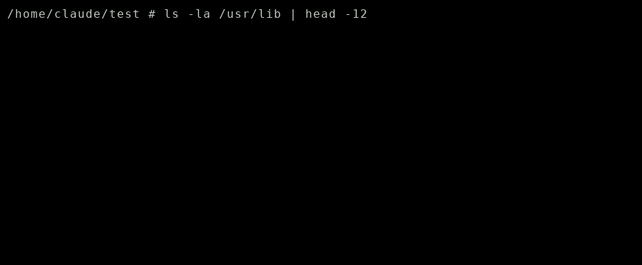

# terminal-matrixfx

Command output in your terminal, written to the screen like the cast credits of *The Matrix Revolutions*.



Lines don't appear all at once. A glowing head streams across each line from left to right, dragging a short ghost trail of random Matrix glyphs, and the real text is left glowing behind it before it settles into its normal colors.

It works in **any terminal emulator** on macOS and Linux: iTerm2, Terminal.app, Ghostty, kitty, WezTerm, Alacritty, GNOME Terminal, Konsole, the VS Code terminal and more.

## Features

- Works on the output of **any command**: `ls`, `git status`, `cat`, scripts, pipelines, ...
- The **whole output of a command always finishes within 1 second**, however long it is.
- Lines start in a quick top-to-bottom wave and all move at the same speed, so short lines finish first.
- The effect **stops at the last character of each line**. Nothing is drawn in the empty space after the text.
- Original colors and layout are kept. Commands still run in a real terminal, so `ls` keeps its columns and colors.
- Full-screen and interactive programs (`vim`, `less`, `top`, `ssh`, REPLs, ...) are never animated.
- Adapts to your terminal: 24-bit color, 256 colors or 16 colors.
- Press any key while an animation runs to skip it.

## How it works

Terminal themes can only change colors, not animate text. Instead, `mfx.py` is a small pseudo-terminal (PTY) proxy that runs your shell inside it:

1. `mfx.zsh` / `mfx.bash` add hooks that print an invisible marker when a command starts and another one when it finishes.
2. `mfx.py` passes everything through untouched (prompt, typed input, full-screen apps) and only animates what arrives between those two markers.
3. Output that moves the cursor around (`clear`, progress UIs, alternate screen) is detected and printed as-is.
4. If you type anything while a command is running, the rest of that command's output is passed through untouched.

## Requirements

- macOS or Linux
- **zsh**, or **bash 4.4 or newer**
  - The bash that ships with macOS is 3.2, which is too old. Use zsh (the macOS default) or install a newer bash with `brew install bash`.
- `python3`
  - macOS: comes with the Xcode Command Line Tools (`xcode-select --install`)
  - Linux: usually preinstalled, otherwise install it with your package manager
- A font that can display half-width katakana (the default fonts on macOS and most Linux desktops can). If you see boxes instead, use `MFX_GLYPHS=ascii` (see [Configuration](#configuration)).

## Installation

```bash
git clone https://github.com/ferhatsanli/terminal-matrixfx.git
cd terminal-matrixfx
sh install.sh
```

Then open a new terminal window or tab.

By default the installer sets things up for your login shell (`$SHELL`). To choose the shells yourself:

```bash
sh install.sh zsh        # only zsh
sh install.sh bash       # only bash
sh install.sh zsh bash   # both
```

`install.sh`:

- copies `mfx.py`, `mfx.zsh` and `mfx.bash` to `~/.mfx/`
- backs up your shell config to `~/.zshrc.before-mfx` / `~/.bashrc.before-mfx` (only the first time)
- adds a small launcher block at the **top** and a hooks block at the **end** of `~/.zshrc` / `~/.bashrc`
- on macOS with bash: makes sure `~/.bash_profile` loads `~/.bashrc`, because macOS terminals start login shells

### Updating

```bash
cd terminal-matrixfx
git pull
sh install.sh
```

Re-running the installer updates the files in `~/.mfx/` and replaces the mfx blocks in your shell config. Installs from older versions are upgraded automatically.

## Usage

Just use your shell as usual. In addition:

| Command   | What it does                          |
|-----------|---------------------------------------|
| `mfx off` | Turn the effect off for this session  |
| `mfx on`  | Turn it back on                       |
| `mfx`     | Show whether the effect is on or off  |

To start a shell without the effect at all, set `MFX_DISABLE=1` before it starts.

## Configuration

Export these environment variables **above** the launcher block at the top of `~/.zshrc` / `~/.bashrc`, for example `export MFX_DURATION=0.6`:

| Variable       | Default  | Description                                                   |
|----------------|----------|---------------------------------------------------------------|
| `MFX_DURATION` | `1.0`    | Total animation time per output burst, in seconds             |
| `MFX_FPS`      | `40`     | Frames per second                                             |
| `MFX_GLOW`     | `1`      | `1` = glowing background around the head, `0` = off           |
| `MFX_COLORS`   | detected | Force a color mode: `truecolor`, `256` or `16`                |
| `MFX_GLYPHS`   | detected | `katakana` or `ascii` (ascii is used on the Linux console)    |

The color mode is detected from `COLORTERM`, `TERM` and `TERM_PROGRAM`. Terminal.app gets 24-bit color on macOS 26 Tahoe and later, and 256 colors on older versions. In 16-color mode the glow is turned off.

The commands that are never animated live in two arrays. Change them after the hooks block in your shell config:

```bash
MFX_SKIP+=(k9s)               # never animated
MFX_SKIP_NOARGS+=(deno)       # not animated when called without arguments (REPL)
```

## Uninstall

```bash
cd terminal-matrixfx
sh uninstall.sh
```

This removes the mfx blocks from your shell config files and deletes `~/.mfx`. Your backups (`*.before-mfx`) are left in place.

## Limitations

- Only **zsh** and **bash 4.4+** are supported. fish and other shells are not supported yet.
- Not started inside Warp, Emacs and dumb terminals, which have their own way of handling command output.
- Commands that produce output continuously (e.g. `ping`, build logs) are animated in bursts. Each burst gets its own 1-second animation.
- When an output is taller than the window, only the part that stays visible is animated. The lines above it are printed instantly.
- Hyperlinks in command output (OSC 8) are dropped.
- If `mfx.py` ever crashes, you fall back to a normal shell, so you are never locked out of your terminal.

## Files

| File           | Purpose                                          |
|----------------|--------------------------------------------------|
| `mfx.py`       | PTY proxy and the animation itself               |
| `mfx.zsh`      | zsh hooks, the `mfx` command and the skip lists  |
| `mfx.bash`     | bash hooks, the `mfx` command and the skip lists |
| `install.sh`   | Installer                                        |
| `uninstall.sh` | Uninstaller                                      |
